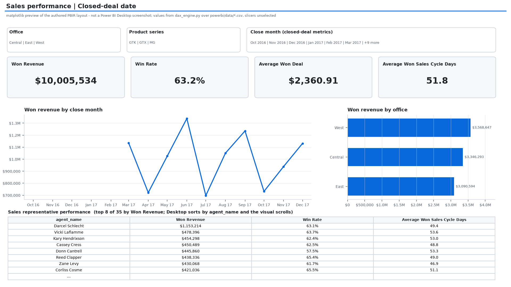
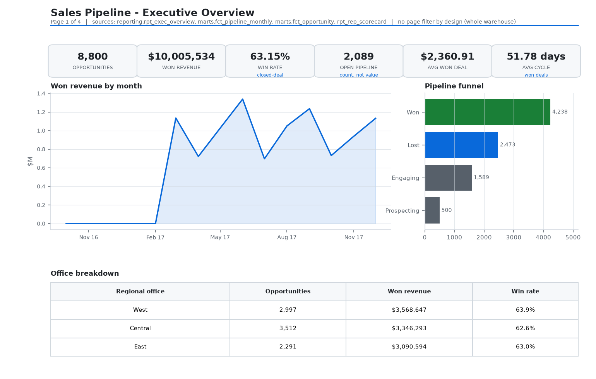

# Sales Pipeline Analytics Warehouse

An ELT warehouse for a CRM sales pipeline, built end to end: Python extracts
and loads CSV into a DuckDB landing schema, dbt models it into star-schema
marts and reporting views, 51 tests prove the numbers, a Streamlit dashboard
renders them, a Power BI project re-implements the same metrics as 13 DAX
measures held to a SQL baseline, and a 40-million-row benchmark measures the
storage-layout optimisation that actually mattered.

Every figure in this README was produced by running the code in this repo. The
commands to reproduce them are below.

```
CSV files ──> etl/extract.py ──> etl/load.py ──> raw.* (DuckDB, landing)
   sha256 + 18 DQ checks                              │
                                                     v
                                    dbt: staging ──> intermediate ──> marts
                                                    (star schema)      │
                                                     reporting (views)  │
                                          ┌────────────────────────────┼───────────┐
                                          v                            v           v
                                   Streamlit dashboard          Looker Studio   BigQuery target
                                   (verified in browser)        spec            (dialect-reviewed,
                                                                                not run live)
```

## Power BI + DAX

An editable [Power BI project](powerbi/README.md) complements the Streamlit app:
three report pages, an import-mode star-schema model, Power Query CSV imports,
and 13 DAX measures. `powerbi/build_project.py` exports the marts to CSV, so
opening `powerbi/SalesPipeline.pbip` needs no Python, DuckDB or credentials -
set the `DataFolder` parameter and refresh.

What is proven: `python powerbi/validate_project.py` holds all 13 measures to a
SQL baseline derived from the dbt marts - whole totals, per office, per product
series, per close month - by re-implementing each measure in Python
(`powerbi/dax_engine.py`) over the same CSVs Power Query imports, then re-checks
every figure published in the guide against that baseline. The same run validates
the report JSON against Microsoft's PBIR schemas, resolves every visual's bound
fields against the model, proves `measures.dax` matches the measures installed in
`model.bim`, and proves the fact table's stage labels are equivalent to the
boolean flags the SQL filters on.



What is not: Power BI Desktop has never opened this project, so the Microsoft DAX
and Power Query (M) engines were never executed, and nothing is published to
Power BI Service. `dax_engine.py` re-implements the definitions rather than
running them, and the PNG above is a matplotlib render of the authored layout,
not a Desktop screenshot. **Desktop refresh and visual rendering remain pending**;
the acceptance steps and expected values are in
[the Power BI guide](powerbi/README.md).

## Quickstart

```bash
pip install -r requirements.txt

python etl/extract.py --offline     # verifies the 5 CSVs in raw_data/ by sha256
python etl/load.py                  # CSV -> raw.* + raw._load_manifest
python etl/profile_source.py        # 18 checks -> reports/source_profile.json

cd warehouse && dbt build --profiles-dir .   # 16 models + 51 tests, all green
cd ../dashboard && streamlit run streamlit_app.py
```

Python 3.14, DuckDB 1.5.6, dbt-core 1.12.5, dbt-duckdb 1.11.0, Streamlit 1.65.0.
`dbt build` reports `PASS=67 WARN=0 ERROR=0`.

## The numbers this warehouse is accountable for

`marts.fct_opportunity` is 8,800 rows over 2016-10-20 → 2017-12-31.

| Metric | Value | Enforced by |
|---|---|---|
| Won revenue | $10,005,534 | `assert_revenue_ties_to_source` (mart vs `raw.sales_pipeline`, to the cent) |
| Win rate (closed deals) | 63.15% | `docs/METRIC_DEFINITIONS.md` + accepted_values on `deal_stage` |
| Open pipeline | 2,089 opportunities | `assert_won_opportunities_have_close_date` |
| Avg won deal | $2,360.91 | `not_null` + `fct_opportunity.revenue` contract |
| Avg won sales cycle | 51.78 days | `assert_no_negative_sales_cycle` |
| Stage counts | 500 Prospecting / 1,589 Engaging / 4,238 Won / 2,473 Lost | funnel on the Exec Overview page |
| Offices | West $3,568,647 · Central $3,346,293 · East $3,090,594 | `rpt_rep_scorecard` rollup |
| Top agent | Darcel Schlecht, $1,153,214 (747 opportunities) | `rpt_rep_scorecard.revenue_rank` |

Three deliberate definitional choices, each of which an analyst downstream would
otherwise get wrong:

- **Revenue is stage-filtered, not `close_value > 0`.** The vendor records every
  Lost deal at `close_value = 0`, so a positivity filter silently agrees with
  the correct definition here and breaks the moment a source starts carrying
  amounts on lost deals. `case when deal_stage = 'Won' then close_value else 0 end`.
- **Open pipeline is a count, never a value.** Nothing in the source carries an
  amount on an open opportunity, so a pipeline *value* would be fabricated.
- **The funnel is not sequential.** 500 + 1,589 + 4,238 + 2,473 = 8,800 is a
  stage *snapshot*, not a conversion path; the dashboard says so in the caption.

`snapshot_date` is `max(close_date)`, not `current_date`, so every rebuild
reproduces identical numbers instead of drifting with the clock.

## Data quality: found, quantified, repaired without touching the source

`etl/profile_source.py` runs 18 checks against the bytes as landed and writes
each result with the SQL that produced it: **1 error, 6 warnings, 11 passes**
(`reports/source_profile.json`).

| ID | Finding | Rows | Treatment |
|---|---|---|---|
| DQ-003 | `sales_pipeline.product` labels don't join to `products.product` (case, punctuation, spacing) | 1,480 | Normalised join key `lower(regexp_replace(...))` in staging. Recovers the rows; the raw label stays on the record. |
| DQ-004 | Opportunities with no account attribution | 1,425 (16.19%) | Kept as nulls, counted, surfaced. Never imputed. |
| DQ-005 | No `engage_date` | 500 | All are Prospecting - correct, not missing. |
| DQ-008 | Null `close_date` | 2,089 | Exactly the open pipeline. |
| DQ-009 | Lost deals recorded at `close_value = 0` | 2,473 | Drives the stage-filtered revenue definition. |
| DQ-015 / DQ-016 | Non-canonical `sector` / `office_location` spellings | 12 / 1 | Repaired in staging with `*_raw` and `is_*_repaired` columns retained. |

The repair policy is the part worth reading: `docs/DATA_QUALITY_FINDINGS.md`.
Nothing edits source data; every repair is a derived column, and
`assert_no_unmapped_products` returns zero rows so the DQ-003 fix is provably
complete rather than assumed.

## Query optimisation, measured on 40,040,000 rows

The real dataset is 8,800 rows, so it cannot demonstrate a storage win.
`optimization/generate_big_dataset.py` amplifies it deterministically (4,550
copies of the observed distribution, seeded by `md5`) into a Parquet dataset,
and `run_benchmark.py` runs 5 interleaved rounds per pair on a fresh connection
with `threads = 4` and `memory_limit = 1 GB` pinned for every query. Full
write-up: [`optimization/RESULTS.md`](optimization/RESULTS.md); machine-readable:
`optimization/results.json`.

| Pair | Question | Baseline | Optimised | Result |
|---|---|---|---|---|
| 1 - layout | Monthly Won revenue, one office, one quarter | 0.233 s, 476.7 MB scanned | 0.035 s, 32.59 MB scanned | **6.5x faster, 93.2% less I/O** |
| 2 - SQL pattern | Latest record per opportunity in a 1-year window | 2.061 s (self-join on `max(load_seq)`) | 1.196 s (`qualify row_number()`) | **1.7x** |

Pair 1 is Hive `year=/month=` partition pruning: the query stops reading files
it cannot possibly need. Pair 2 is the honest result of a rewrite that reads
the source once instead of twice - modest, because DuckDB's hash join was
already efficient at this scale. **The lever that moved the needle was layout,
not SQL style**, and that is the conclusion this benchmark argues for. The same
pair maps directly onto BigQuery, where scanned bytes are the bill: partition by
`close_date`, cluster by `office`, filter on the partition column.

This benchmark dataset is not used by any analytics in the repo - no model,
test, or page reads it. It exists only to measure the two queries.

## Layers

| Layer | Contents | Grain |
|---|---|---|
| `raw` | 5 CSV tables + `_load_manifest` (run_id, row_count, sha256, loaded_at, duration_ms) | source row |
| `staging` | 1:1 typed repairs of raw, `source.`-qualified columns | source row |
| `intermediate` | `int_opportunity_enriched`, `int_data_quality_flags` (long-format) | opportunity / opportunity × check |
| `marts` | `fct_opportunity`, `fct_pipeline_monthly`, `dim_account`, `dim_product`, `dim_sales_agent`, `dim_date` (438 rows) | opportunity / month × office |
| `reporting` | `rpt_exec_overview`, `rpt_pipeline_health`, `rpt_rep_scorecard`, `rpt_data_quality` | view, BI-facing |

`fct_pipeline_monthly` is built on a month × office grid, so a month with zero
closes still emits a row - a BI trend line cannot invent the gap itself.

## Portability: one set of models, two targets

`warehouse/profiles.yml` defines `duckdb_dev` (default) and `bigquery_prod`.
The models are unchanged between them; only the macros in
`warehouse/macros/compat.sql` recompile (`datediff_days`, `date_trunc_to`,
`safe_cast`, `date_spine`, `surrogate_key`). Writing for both dialects forced
rules that made the SQL better in isolation too: `sum(case when ... then 1 else
0 end)` instead of DuckDB's `count_if` / BigQuery's `COUNTIF`, no `QUALIFY` in
models, and a `date_spine` that emits a FROM-clause fragment because BigQuery
has no `generate_series` table function.

**Status, stated plainly:** the DuckDB target is executed and tested. The
BigQuery target is configured and dialect-reviewed but has never been run live -
see `bigquery/DEPLOY_TO_BIGQUERY.md`, which opens with that sentence and ends
with a claims/evidence table. `bigquery/ddl_warehouse.sql` has the native DDL
(partitioning, clustering, a materialised view, and the
`INFORMATION_SCHEMA.JOBS_BY_PROJECT` cost query) for whoever holds a GCP project.

## BI surfaces

- **`dashboard/`** - Streamlit multipage app (Exec Overview · Pipeline Health ·
  Rep Scorecard · Data Quality), opened and checked in a browser. It reads only
  `marts.*` and `reporting.*` through a read-only connection, so a page cannot
  display anything the tests have not approved. Filters are page-level on
  purpose: only `rpt_pipeline_health` and `rpt_rep_scorecard` carry a
  `regional_office` column, so a report-wide control would sit in the sidebar
  doing nothing on two of four pages.
- **`powerbi/`** - the editable Power BI Project described above: three pages, an
  import-mode model, 13 DAX measures, and a page preview rendered from the
  committed PBIR JSON by `powerbi/render_report_previews.py`. Same convention as
  the Looker previews - matplotlib renders of the real numbers, not screenshots,
  because a Power BI report only exists once someone opens it in Desktop.
- **`docs/LOOKER_STUDIO_SPEC.md`** - field-by-field build spec for the same four
  pages over the same views, including the filter scoping above, the "do not
  average `win_rate` across grains" warning, matching theme colours, and an
  acceptance check listing the exact values the built report must reproduce.
  Each page carries a preview rendered by `docs/render_looker_previews.py` from
  the built warehouse, so the spec is reviewable without a Google account. Those
  PNGs are matplotlib renders of the real `reporting.*` views, not Looker Studio
  screenshots - a Looker Studio report has no file format and can only exist
  inside an account, which is exactly why the spec is a build sheet.



## CI

`.github/workflows/ci.yml` runs extract → load → profile → `dbt build` →
`dbt source freshness` on every push and PR, and uploads the dbt artifacts.
`.github/workflows/nightly_pipeline.yml` is a cron at 17:30 UTC (23:00 IST /
09:30 PST) with `--refresh`, standing in for the Cloud Composer / Airflow
scheduler the role description asks about - same DAG shape (extract, load,
transform, test, freshness), different orchestrator.

## Repo map

```
etl/            extract.py · load.py · profile_source.py
raw_data/       5 source CSVs (Maven Analytics CRM Sales Opportunities)
warehouse/      dbt_project.yml · profiles.yml · macros/ · models/ · tests/
dashboard/      streamlit_app.py · db.py · app_pages/ · .streamlit/config.toml
powerbi/        SalesPipeline.pbip · .SemanticModel/ · .Report/ · data/ · measures.dax
                build_project.py · validate_project.py · dax_engine.py · render_report_previews.py
optimization/   generate_big_dataset.py · run_benchmark.py · RESULTS.md · results.json
bigquery/       ddl_warehouse.sql · DEPLOY_TO_BIGQUERY.md
docs/           METRIC_DEFINITIONS.md · DATA_QUALITY_FINDINGS.md · LOOKER_STUDIO_SPEC.md
reports/        source_profile.json (18 checks, with their SQL)
```

The incidental outputs are gitignored - `*.duckdb`, `warehouse/target/`, `logs/`,
and the ~2 GB benchmark Parquet. What is committed is derived by a script named
in the section that owns it: `reports/source_profile.json`
(`etl/profile_source.py`), the Looker and Power BI page previews (the two
`render_*_previews.py`), and `powerbi/data/*.csv` with
`powerbi/expected_kpis.json` (`powerbi/build_project.py`). Credentials come from
environment variables only - no keyfile in the tree, and `.gitignore` blocks
`service-account*.json` anyway.

## What this project is not

It is a single static CSV extract, not a CDC feed from a live CRM, so there is
no incremental-model story here beyond the manifest and idempotent loads. The
BigQuery target has not been executed. The Power BI project is verified by
re-implementing its measures against the warehouse, not by running them: Power BI
Desktop has never opened it and nothing is published to Power BI Service. The
benchmark dataset is synthetic amplification, used only for the two measured
queries. The source is a public sample dataset from Maven Analytics
([CRM Sales Opportunities](https://mavenanalytics.io/data-playground/crm-sales-opportunities));
no proprietary or personal data is in this repository.
