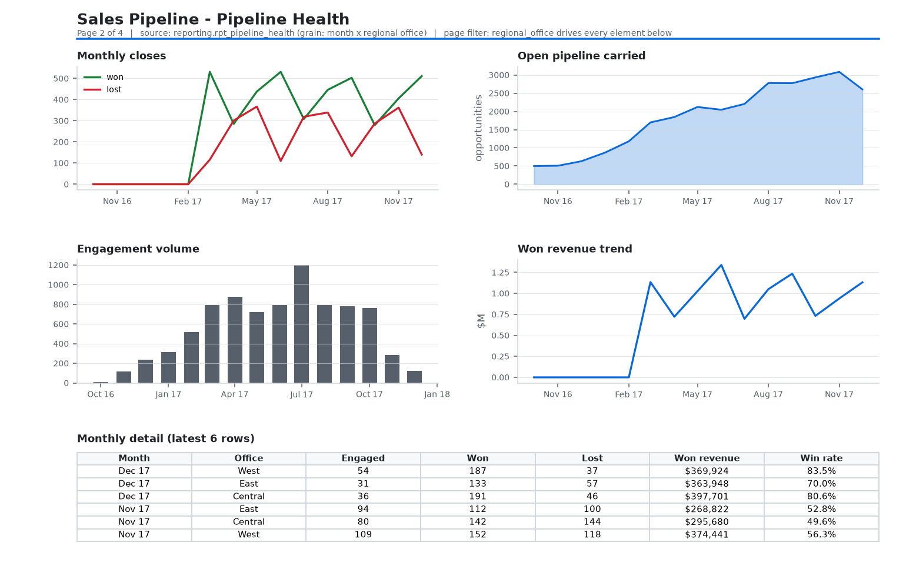
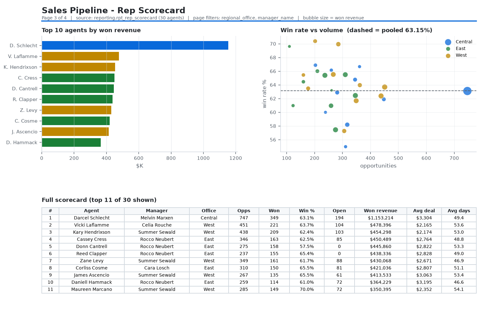
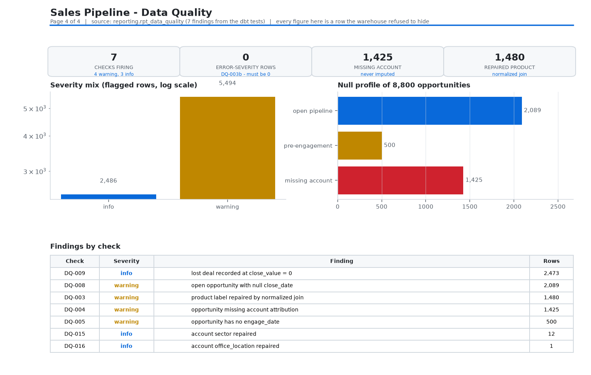

# Looker Studio report spec

The four pages of `dashboard/` are the executable version of this spec - the
Streamlit app is browser-verified proof that the queries and layouts work.
Looker Studio itself cannot be built from code, so this file is the build
sheet: one section per page, each naming the exact table/field, aggregation
and filter. Point a Looker Studio connector at the BigQuery `reporting`
dataset (see `bigquery/DEPLOY_TO_BIGQUERY.md`) and every page below is a
drag-and-drop, no SQL required.

Each page section carries a preview image so the sheet can be reviewed without
a Google account. **Those images are matplotlib renders of the real warehouse
views, not Looker Studio screenshots** - Looker Studio has no file format for a
report, so a layout can only exist inside someone's account. What the previews
prove is the part that matters: the field set, the aggregation, the chart type
and the numbers. Regenerate them after any warehouse change:

```
python docs/render_looker_previews.py   # reads warehouse/crm_warehouse.duckdb
```

## Data source setup (once)

| item | value |
|---|---|
| Connector | BigQuery |
| Project | your GCP project |
| Dataset | `analytics` (dbt `marts`/`reporting` schemas; see profiles note) |
| Tables | `reporting.rpt_exec_overview`, `reporting.rpt_pipeline_health`, `reporting.rpt_rep_scorecard`, `reporting.rpt_data_quality` |
| Refresh | connector default; warehouse rebuilds nightly via CI |

Looker Studio treats a dbt view as a table with dimensions and measures. The
views are pre-aggregated to the grain each page needs, so **no calculated
fields are required for the metrics themselves** - aggregation should be SUM
only on additive measures and AVG never (rates are already computed per grain;
re-averaging them is wrong).

Field roles to set on connect (Studio auto-detects most):
- `month_start`, `engage_date`, `close_date` → Date dimension
- `regional_office`, `deal_stage`, `agent_name`, `manager_name`, `sector` → Text
- `win_rate`, `win_rate_pct` → Number, percent format (do not aggregate; use
  at the row grain shown)
- `revenue`, `won_revenue`, `total_revenue` → Number, currency USD

Filter scoping (mirrors the Streamlit app one for one):
`regional_office` (drop-down, multi-select) belongs on the **Pipeline Health**
and **Rep Scorecard** pages only - those two views carry the column.
`rpt_exec_overview` is pre-aggregated to a single row and `rpt_data_quality`
describes the source as landed, so a report-wide control would sit in the
header doing nothing on two of four pages. Put the filter in each page's own
header and label the unfiltered pages as whole-warehouse.

## Page 1 - Exec Overview


| element | type | source | fields |
|---|---|---|---|
| Opportunities | Scorecard | `rpt_exec_overview` | `total_opportunities` (SUM) |
| Won revenue | Scorecard | `rpt_exec_overview` | `total_revenue` (SUM, $) |
| Win rate | Scorecard | `rpt_exec_overview` | `win_rate` (formatted %) |
| Open pipeline | Scorecard | `rpt_exec_overview` | `open_pipeline_count` (SUM) |
| Avg won deal | Scorecard | `rpt_exec_overview` | `avg_won_deal_size` ($) |
| Avg cycle | Scorecard | `rpt_exec_overview` | `avg_won_cycle_days` (days) |
| Won revenue by month | Time series | `rpt_pipeline_health` | date `month_start`, measure `won_revenue` (SUM) |
| Pipeline funnel | Bar (horizontal) | `fct_opportunity` or a stage rollup | dimension `deal_stage`, measure `opportunity_id` (COUNT) |
| Office breakdown | Table | `rpt_rep_scorecard` grouped | dims `regional_office`; measures `total_revenue` (SUM), opportunity count |

Caption to include verbatim on the page: "Win rate is closed-deal
(won / (won + lost)). Open pipeline is a count - the source records no amount
until a deal closes."

## Page 2 - Pipeline Health


| element | type | source | fields |
|---|---|---|---|
| Monthly closes | Combo (lines) | `rpt_pipeline_health` | date `month_start`; series `won_count`, `lost_count` (SUM) |
| Open pipeline carried | Area | `rpt_pipeline_health` | date `month_start`, `open_pipeline_count` (SUM) |
| Engagement volume | Bar | `rpt_pipeline_health` | date `month_start`, `engaged_count` (SUM) |
| Won revenue trend | Line | `rpt_pipeline_health` | date `month_start`, `won_revenue` (SUM) |
| Monthly detail | Table | `rpt_pipeline_health` | all columns, sorted `month_start` desc |

Filter: the page-level `regional_office` control drives every element here.
Because the mart is at (month, office) grain, a multi-office table row is one
office-month - no double counting.

Do **not** add a "total win rate" pivot that averages `win_rate` across rows;
at mixed grains the correct figure is `SUM(won_count) / SUM(won_count +
lost_count)`, which needs a calculated field if you want it report-wide.

## Page 3 - Rep Scorecard


| element | type | source | fields |
|---|---|---|---|
| Top 10 by revenue | Bar (horizontal) | `rpt_rep_scorecard` | dim `agent_name`, measure `total_revenue` (SUM), sort desc, row limit 10 |
| Win rate vs volume | Scatter | `rpt_rep_scorecard` | X `total_opportunities`, Y `win_rate`, series `regional_office`, size `total_revenue` |
| Full scorecard | Table | `rpt_rep_scorecard` | all columns; `revenue_rank` ascending |

Notes:
- Scatter Y must stay a per-agent measure (`win_rate` is unique per
  `agent_name`, so SUM is safe here).
- `open_pipeline_count` on this page is a carried count, not a value.
- Filter: `manager_name` drop-down mirrors the Streamlit page.

## Page 4 - Data Quality


| element | type | source | fields |
|---|---|---|---|
| Checks firing | Scorecard | `rpt_data_quality` | `check_id` (COUNT) - currently 7: 4 warning, 3 info |
| Error-severity rows | Scorecard | `rpt_data_quality` | `flagged_rows` (SUM) filtered `severity = error` - **0, and 0 is the pass condition**: `DQ-003b` is the only error-severity check and it asserts that every product label resolves after the normalized join |
| Findings by check | Table | `rpt_data_quality` | dims `check_id`, `severity`, `finding`; measure `flagged_rows` (SUM) |
| Severity mix | Bar, log y-axis | `rpt_data_quality` | dim `severity`, measure `flagged_rows` (SUM) - not a donut: two slices at 5,494 and 2,486 are harder to compare as angles than as lengths, and a third severity can appear with a value near zero |
| Null profile | Bar | `fct_opportunity` | dims `is_account_missing`, `is_pre_engagement`; measure `opportunity_id` (COUNT) |
| Product repair callout | Text + scorecard | `int_opportunity_enriched` | count where `is_product_key_repaired` = 1,480 |

Interpretation text to keep next to the table (prevents the classic
misreading): "DQ-008 is the open pipeline (2,089 = 500 Prospecting + 1,589
Engaging). These nulls are correct and are never imputed. DQ-003 rows are
repaired by a normalized join; the raw label stays on the row."

## Layout and style

- 4 pages in the order above; the `regional_office` control lives in the header
  of pages 2 and 3 only (see Filter scoping), not in a report-wide header.
- Currency USD, no thousands separators on scorecards (crowding), 1 decimal on
  rates.
- Theme: primary `#0969da`, neutrals `#f6f8fa` / `#d0d7de`, severity colors
  red `#cf222e`, orange `#bf8700`, blue `#0969da` (matches
  `dashboard/.streamlit/config.toml` so both BI surfaces read the same).

## Acceptance check

The built report must reproduce these values from the Streamlit app exactly
(they are the tested warehouse numbers): 8,800 opportunities · win rate
63.15% · $10,005,534 won revenue · 2,089 open · avg won deal $2,360.91 · avg
won cycle 51.78 days · 1,480 repaired product labels · 1,425 unattributed
opportunities · top agent Darcel Schlecht $1,153,214. Any mismatch means the
connector is pointing at a different build, not that the metric moved.
