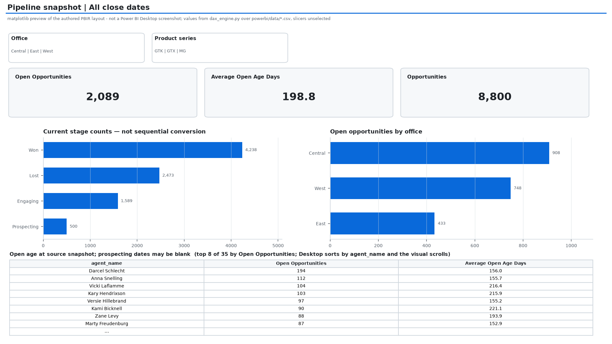
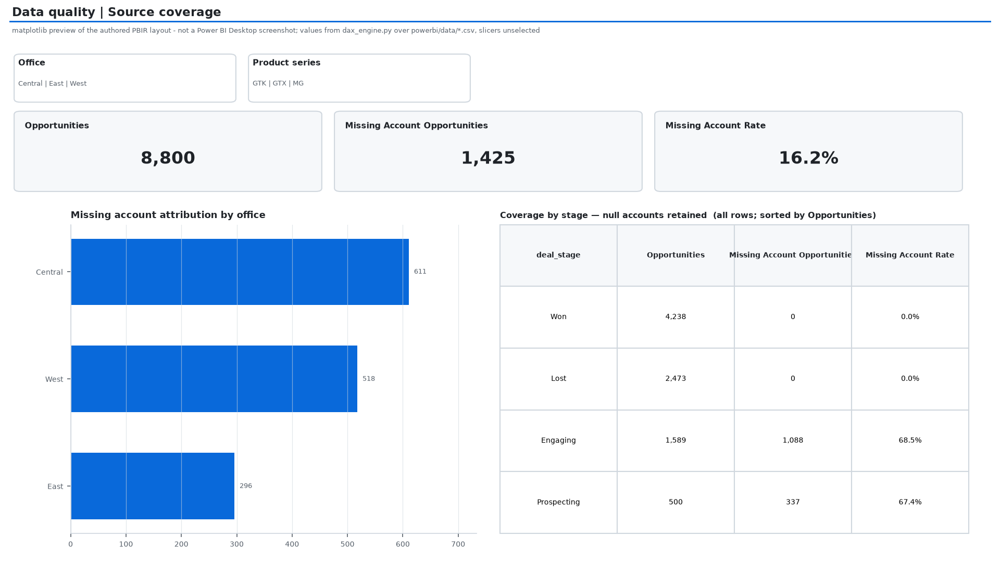

# Sales Pipeline — Power BI + DAX

Editable **Power BI Project (PBIP)** source: three report pages, an import-mode
semantic model, four one-to-many relationships, Power Query CSV imports, and
13 DAX measures. The CSV snapshots are exported from the existing dbt marts;
they are included so opening the report does not require Python or DuckDB.

**Validation status:** `python powerbi/validate_project.py` passes every check it
runs. It holds all 13 measures to a SQL baseline derived from the dbt marts —
whole numbers, per office, per product series, per close month — by
re-implementing each measure in Python (`dax_engine.py`) over the same CSVs
Power Query imports, then re-checks every figure in this file against that
baseline. Report JSON conforms to Microsoft's published PBIR schemas, every
visual's field references resolve against the model, `measures.dax` matches what
is installed in `model.bim`, and the fact table's stage labels are proven
equivalent to the boolean flags the SQL baseline filters on.

What that does **not** cover: the Microsoft DAX engine and the Power Query (M)
engine were never executed, and Power BI Desktop is not installed in this
environment. `dax_engine.py` re-implements the measure definitions; it does not
re-run them. **Desktop opening, Power Query refresh, and visual rendering still
require the acceptance steps below.** This is authored project source, not an
already Desktop-validated `.pbix` or a published Power BI Service report.

## The three pages, rendered

Layout comes from the committed PBIR JSON and every figure from
`dax_engine.py` over `powerbi/data/*.csv`, so `python
powerbi/render_report_previews.py` regenerates these with no warehouse,
credentials or Power BI install. **They are matplotlib previews of the authored
layout, not Power BI Desktop screenshots** — Desktop sorts table and bar rows by
their category and scrolls, these sort by the measure so a page reads at a
glance, and slicers are drawn unselected, which is how the report opens.






## Open on Windows

1. Download the repository ZIP from GitHub (Code → Download ZIP) and extract it.
   Keep the complete `powerbi` folder together.
2. Open `SalesPipeline.pbip` in a current Power BI Desktop version supporting
   PBIP/PBIR. The project initially has no imported data cache.
3. In **Transform data → Edit parameters**, set `DataFolder` to the absolute
   path of the extracted `powerbi/data` directory, for example
   `C:/Users/YourName/Downloads/sales-pipeline-analytics-warehouse-main/powerbi/data`.
4. Apply changes and **Refresh**. Allow local-file access if prompted.
5. Check the three pages and run `SalesPipeline.SemanticModel/DAXQueries/Acceptance.dax`
   in DAX Query View. Compare the results below. Save a local `.pbix` after checks.

The model's editable Power Query parameter is in `model.bim`. There are no
credentials, cloud connectors, paid visuals, or online data dependencies.

## Pages and filter semantics

| Page | Contents | Date meaning |
|---|---|---|
| Sales performance | Revenue, win rate, average won deal, sales cycle, monthly trend, office revenue, representative table | Close-month slicer filters closed deals through the active date relationship |
| Pipeline snapshot | Open count, open age, stage counts, office and representative breakdowns | No date slicer; snapshot of the source extract, not historical pipeline movement |
| Data quality | Missing account counts and rates by office and stage | All source opportunities, including unclosed deals |

Office and product-series slicers are local to each page. They filter the
fact via single-direction relationships. Open-count and open-age measures
explicitly remove date-dimension filters: an open deal has no close date.
Stage charts show a snapshot, **not a sequential conversion funnel**.
Average open age excludes records without engagement dates (including
pre-engagement prospecting). The snapshot date comes from the source's max
close date, not today's date. Missing account rows remain in the fact.

## Model

`dim_sales_agent[sales_agent_key]`, `dim_product[product_key]`,
`dim_account[account_key]` each filter their matching fact key.
`dim_date[date_day]` filters `fct_opportunity[close_date]`.
All relationships are one-to-many, dimension to fact, single direction.
Raw numeric columns use “Do not summarize”; report visuals use explicit measures.

## DAX acceptance values (clear all filters)

| Measure | Expected |
|---|---:|
| Opportunities | 8,800 |
| Won Deals | 4,238 |
| Closed Deals | 6,711 |
| Won Revenue | $10,005,534 |
| Win Rate | 63.150052% |
| Average Won Deal | $2,360.909391 |
| Average Won Sales Cycle Days | 51.781973 |
| Open Opportunities | 2,089 |
| Average Open Age Days | 198.816237 |
| Missing Account Opportunities | 1,425 |
| Missing Account Rate | 16.193182% |

Win rate = Won / (Won + Lost), never Won / all opportunities.
Revenue is explicitly restricted to Won. Open pipeline has **no dollar value**
because the source does not provide one. DAX uses KEEPFILTERS so stage
selections intersect measure definitions rather than replace them.

Also verify: West office revenue = $3,568,647; Central = $3,346,293;
East = $3,090,594. Select an office and product series to check cross-filtering;
clear them to restore totals. On the executive page select a close month and
confirm revenue changes. Pipeline page remains a snapshot.

### Three behaviours the verification pinned

These are the places where a measure can read plausibly and still be wrong, so
they are asserted rather than described.

**`DATEADD` on `dim_date[date_day]` truncates the prior month.** `Revenue
Previous Month` shifts the filtered day set back one month, so a 30-day month
can never reach day 31 of the month before it. April, June, September and
November 2017 therefore read $24,139, $22,800, $7,829 and $17,131 short of the
whole previous calendar month. `expected_kpis.json` stores both the shifted and
the calendar figure per month, and the validator proves the model produces the
shifted one. It is the standard DAX idiom behaving as documented, not a defect —
but a reader comparing against a month-total would call it a bug.

**Read at all-time grain the MoM pair is meaningless, and it is not blank.**
With no date filter, `DATEADD` still shifts all 438 days of `dim_date`, which
silently drops December and every unreachable day 31. `Revenue Previous Month`
evaluates to $8,802,062 against $10,005,534 of won revenue, so an unfiltered
card shows **+13.67% growth** out of nothing. Inspect both measures at
individual month grain; a missing or zero prior-month denominator returns blank,
which is March 2017's case.

**Missing account attribution is entirely on open deals.** The 1,425 unattributed
rows are 1,088 Engaging and 337 Prospecting — zero Won, zero Lost. The rate is
68.5% of engaging and 67.4% of prospecting deals against 0% of closed ones, so
"missing account" is a statement about how far the CRM record has been filled in,
not about a random data defect. The rows are kept in the fact deliberately.

## Rebuild from refreshed warehouse data

Run the existing extract/load/dbt workflow first, then from repository root:

```sh
python powerbi/build_project.py
python -m pip install jsonschema
python powerbi/validate_project.py
python powerbi/render_report_previews.py
```

`build_project.py` regenerates the CSV snapshots, PBIP/PBIR definitions,
semantic model, DAX reference and the SQL baseline in `expected_kpis.json`. It
overwrites authored report files: commit Desktop edits before rebuilding and
review the diff. Current KPI assertions deliberately pin the public sample
dataset; update them with reviewed expectations when intentionally replacing the
source. `render_report_previews.py` needs none of that - it reads the committed
CSVs and PBIR JSON, so it runs on a fresh clone.

`validate_project.py` is where the claim is earned. It compares artefacts built
by different code: Microsoft's schemas against the report JSON, `measures.dax`
and `Acceptance.dax` against the measures installed in `model.bim`, every
visual's bound fields against the model's tables, the stage labels against the
boolean flags the SQL filters use, `dax_engine.py` against the SQL baseline, and
this file's published numbers against the same baseline. It exits non-zero on
any mismatch and prints which comparison failed. It **does not run the Microsoft
DAX or M engines**. `measures.dax` is a readable reference; measures are already
installed in the model. The `.pbi` cache and local Desktop settings must not be
committed.

## Format references

- https://learn.microsoft.com/en-us/power-bi/developer/projects/projects-report
- https://learn.microsoft.com/en-us/power-bi/developer/projects/projects-dataset
